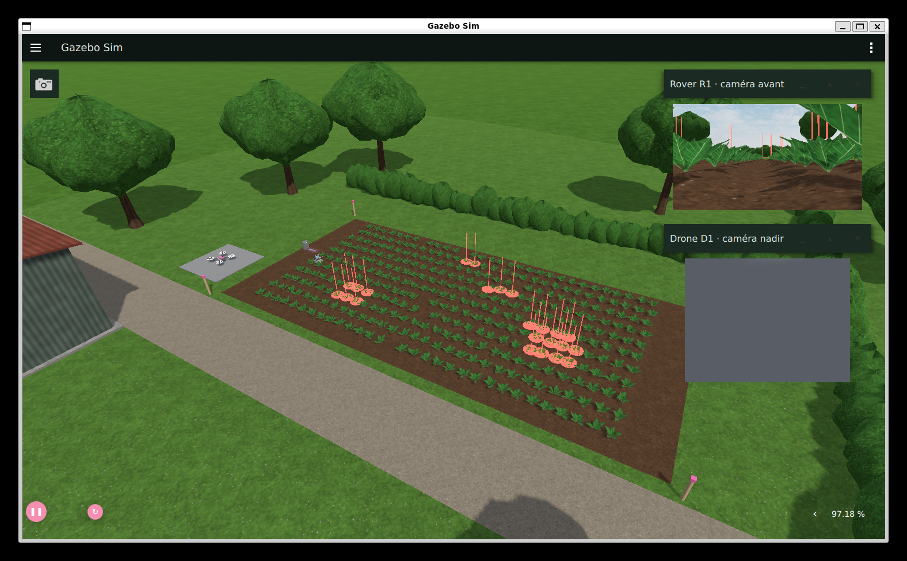

# Vigie Betterave · Rover & Drone agricole

Projet technique HEI4 / ISEN4 Robotique 2026-2027 (JUNIA) : détection et traitement localisé de la
cercosporiose de la betterave sucrière par un drone (repérage) et un rover (confirmation, mesure, pulvérisation).
Ce dépôt contient la **simulation complète** du semestre 7 (ROS 2 Jazzy, Gazebo Harmonic).



## Contenu

| Dossier | Rôle |
|---|---|
| `agri_sim/` | Monde Gazebo (parcelle P-07, 11 rangs de betteraves, décor), modèles du drone et du rover, interface Gazebo, lancement |
| `vigie_detection/` | Nœuds ROS 2 : `drone`, `mission`, `detecteur`, `meteo`, `bilan`, `passerelle` ; console web (`console/`) |
| `outils/` | Scripts de lancement et de test (voir plus bas) |

## Lancer la simulation

Depuis Windows : double-clic sur `Lancer_Simulation.bat` (copie dans `outils/`). Il ouvre Gazebo puis la console sur
`http://localhost:8420` (connexion obligatoire).

Depuis le terminal Ubuntu :

```bash
cd ~/turtlebot3_ws && colcon build --symlink-install --packages-select agri_sim vigie_detection
~/lancer_vigie.sh            # copie : outils/lancer_vigie.sh
```

## Accès à la console

La console est servie par `passerelle.py`, qui est la seule porte d'entrée vers ROS 2 (rosbridge n'écoute que sur
127.0.0.1). Comptes dans `~/.vigie/` (jamais dans ce dépôt). Au premier lancement, un compte `admin` est créé avec un mot
de passe aléatoire écrit dans `~/.vigie/identifiants_initiaux.txt` ; le changement est obligatoire à la première
connexion. Rôles : `admin`, `operateur`, `observateur` (lecture seule, mais l'arrêt d'urgence reste disponible).
Mot de passe perdu : `ros2 run vigie_detection passerelle --reset-admin`.

## Principe de la mission

1. Le drone décolle, survole la parcelle en deux passes, détecte les plants jaunis (couleur) et les géolocalise.
2. Le rover va sur chaque plant, le confirme avec sa caméra (azimut) et son LiDAR, puis pulvérise de l'eau (6 mL).
3. Mode dégradé (drone indisponible) : le rover parcourt seul les allées pour repérer les foyers, puis les traite.
4. Le nœud `bilan` compare tout à la vérité terrain du monde Gazebo et aux critères de la note de clarification.

Le positionnement du rover utilise `/rover/gnss`, un GNSS RTK simulé : l'odométrie des roues dérive de plusieurs
centimètres après des virages sur place.

## Tests

- `outils/test_passerelle.py` : 40 vérifications (authentification, rôles, filtrage des commandes, blocage, audit) sur une
  instance isolée (`VIGIE_DATA=/tmp/vt VIGIE_PORT=8421`).
- `outils/run_test.sh <normal|degrade> <durée_s>` : mission complète sans fenêtre, avec bilan final.
- `outils/inject_test.sh` + `inject.py` + `events.py` : traitement seul avec injection des plants, et tests de sécurité
  (arrêt d'urgence, obstacle, perte de liaison).

## Intelligence artificielle

- Modèle : ResNet18 (poids ImageNet) réentraîné sur le jeu public PSNC Cercospora de la betterave (Zenodo, CC-BY-4.0, 909 photos).
  Scripts dans `vigie_detection/ia/` : `telecharger_jeu.py`, `entrainer.py`, `affiner_sim.py`, `exporter_onnx.py`.
  Le modèle exporté en ONNX est lu par OpenCV (`classifieur.py`) : les nœuds ROS n'ont pas besoin de PyTorch.
- Test public (images jamais vues) : 97,7 % d'exactitude équilibrée avant adaptation, 94,5 % après adaptation à la simulation
  (recadrages JPEG et flous). Objectif de la note : 80 %. Réserves : 27 feuilles saines seulement dans le test, découpage par image.
- `ia/evaluer_detection_aerienne.py` : sur les vues enregistrées du drone, rappel 97 % (malades) et 93 % (débuts), 2,6 % de fausses alertes.

## Résultats mesurés (un seul essai chacun)

| Essai | Plants malades traités | Erreur de jet | Hors cible | Durée |
|---|---|---|---|---|
| Mode dégradé (rover seul, caméras latérales) | 18 / 18 | 2,6 cm | 0 | 17 min |
| Mission complète avec IA | 18 / 18 | 2,7 cm | 0 | 11,8 min |

En vol, la détection aérienne par IA ne retrouve que 9 malades sur 18 ; les caméras latérales du rover rattrapent le reste.
Cause non encore élucidée (flou de mouvement, décalage de position ?).

## Limites connues

- Détection aérienne en vol : rappel de 50 % seulement (97 % sur vues enregistrées) ; vérification par les caméras du rover.
- Simulation : seulement 6 modèles de plants, donc le test sur plants simulés est bien plus facile que sur de vraies feuilles.
- Terrain plat à buttes : pas de relief irrégulier.
- Images de synthèse très propres : les performances réelles seront moins bonnes.
- Les marqueurs de texte de Gazebo ne s'affichent pas avec le moteur ogre2 ; les repères sont des modèles 3D.

## Pièges rencontrés

- Textures de même nom dans plusieurs modèles : Ogre les met en cache par nom (tous les plants paraissaient verts).
- Pas de physique à 1 ms : 0,4× le temps réel ; 4 ms : 1,0×.
- `pkill -f gz` dans une commande contenant « gz » se tue lui-même : utiliser `pkill -f "[g]z sim"`.
- Une tâche de fond lancée par `wsl ... &` meurt avec la commande WSL appelante.
- Le port 8080 est parfois pris sur le PC Windows : la passerelle utilise 8420.
- Gazebo tué par SIGTERM crée des copies mémoire de plusieurs Go (Temp\wsl-crashes) : `ulimit -c 0` et `pkill -9 -f "[g]z sim"`.

## Modèle d'IA fourni

`vigie_detection/ia/modele/modele_cercospora_sim.onnx` (45 Mo) : modèle final, à copier dans `~/ia/modele/` pour que les nœuds
le trouvent (ou variable `VIGIE_MODELE`). Métriques : `metriques.json` (test public) et `metriques_sim.json` (adaptation à la simulation).
`docs/Lancer_Simulation.bat` lance la simulation depuis Windows (WSL2 + ROS 2 Jazzy + Gazebo Harmonic requis).

## Données et licences

Jeu de données : PSNC « Cercospora leaf spot of sugar beet », Zenodo, licence CC-BY-4.0 (non redistribué ici ; `ia/telecharger_jeu.py`
le télécharge). Le modèle de départ est un ResNet18 pré-entraîné sur ImageNet (torchvision).
